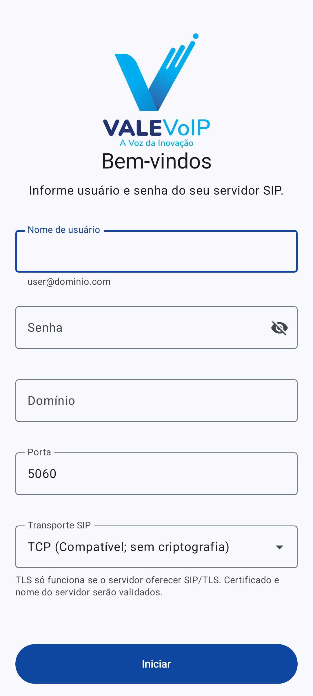
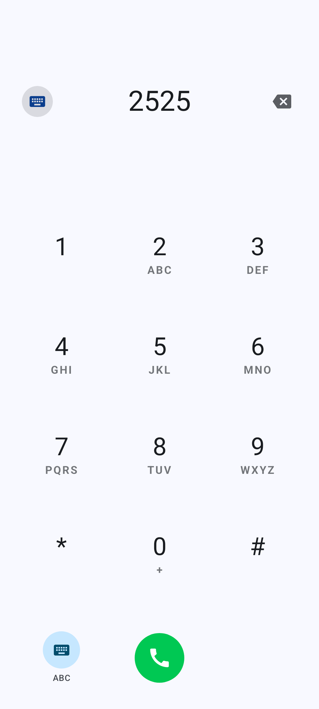

# Vale VoIP 📞

Bem-vindo ao repositório do **Vale VoIP**, um aplicativo Android nativo focado em comunicação corporativa por voz sobre IP (**SIP/VoIP**). Projetado para atuar como um ramal móvel inteligente, seguro e resiliente, o aplicativo integra-se de forma transparente com servidores SIP e centrais PABX (como Asterisk, FreePBX, Issabel e OpenSIPS).

Este projeto foi desenvolvido como **Trabalho de Conclusão de Curso (TCC)**, com o objetivo de demonstrar a aplicação prática de **Clean Architecture**, princípios **SOLID**, segurança criptográfica fim a fim e engenharia de software moderna no ecossistema Android.

---

## 🚀 Sobre o Projeto

O **Vale VoIP** apresenta uma interface moderna construída 100% com **Jetpack Compose (Material 3)** — com suporte completo a **Light Mode** e **Dark Mode** — e uma arquitetura modularizada em **15 módulos independentes**. O motor SIP/RTP utilizado é a **liblinphone (`5.5.13`)**, totalmente isolado atrás de contratos de domínio puro (`:core:domain`), garantindo baixo acoplamento, alta testabilidade e facilidade de evolução.

### 📋 Principais Funcionalidades

De acordo com o nosso [documento de especificações e requisitos técnicos](docs/requirements.md), o aplicativo dispõe de:

- **Autenticação SIP Multi-Protocolo (RF01):** Registro de conta com Usuário/Ramal, Senha, Domínio/IPv4, **Porta customizável** (`5060` por padrão) e seletor Material 3 para transporte **UDP**, **TCP** ou **TLS**.
- **Discador Híbrido Numérico e Alfanumérico (RF02):** Alternância fluida entre o teclado numérico T9 (`123`) e o modo alfanumérico (`ABC`) para discar tanto para ramais numéricos (`2525`) quanto para usernames/endereços SIP (`valevoip`, `usuario@dominio`), com suporte a colagem rápida.
- **Recebimento Contínuo em Segundo Plano (RF03):** Operação resiliente via *Foreground Service* compatível com Android 14/15 (`API 35`), reconexão automática de rede e notificações com ações rápidas (`Atender`, `Recusar`, `Desligar`).
- **Roteamento de Áudio Multi-Dispositivo (RF04):** Controle de `Mute/Unmute`, `Viva-voz` e seletor modal (`AudioRouteBottomSheet`) para **Bluetooth**, **Fone com fio/USB**, **Viva-voz** e **Telefone (Auricular)**, com ativação inteligente do sensor de proximidade apenas no modo auricular.
- **Chamada em Espera (Hold) & Teclado DTMF (RF05):** Suporte a pausa e retomada de chamadas (`re-INVITE` SDP) e envio de tons **DTMF** (`DtmfKeypadBottomSheet`) para navegação em URAs de atendimento.
- **Histórico de Chamadas Completo (RF06):** Registro de chamadas efetuadas, recebidas e perdidas com busca em tempo real, filtro de perdidas, rediscagem rápida e exclusão individual ou total.
- **Gerenciamento de Codecs de Áudio & Indicador SDP (RF07):** Seleção de codecs habilitados (`OPUS 48 kHz`, `PCMU G.711 µ-law`, `PCMA G.711 A-law`, `G722`, `GSM`, `Speex`, `L16`) via `ModalBottomSheet` e exibição em tempo real, na tela de chamada, do codec negociado via SDP (ex.: `OPUS • 48 kHz`).
- **Segurança SRTP, Controle de Bateria & Diagnóstico (RF08):** Ativação de **Criptografia de Mídia (`SRTP`)**, Cancelamento de Eco (`AEC`), modo *Apenas Wi-Fi*, verificação de *Doze Mode* (otimização de bateria) e exportação de **Relatório de Diagnóstico Técnico** para suporte (em conformidade com a LGPD, sem exposição de senhas).

---

## 🧩 Arquitetura e Modularização (15 Módulos)

A construção do software segue os limites arquiteturais da **Clean Architecture** e os princípios **SOLID**:

```text
vale-voip/
├── app/                     # App Shell, MainActivity, AppNavHost e configuração R8/Signing
├── build-logic/             # Gradle Convention Plugins (Application, Library, Feature, Compose, Hilt)
├── core/
│   ├── domain/              # 100% Kotlin Puro (Entities, UseCases e Contratos/Ports sem Android SDK)
│   ├── sip/                 # Implementação LinphoneSipClient, AudioCodecMapper e TransportConfig
│   ├── telecom/             # VoipForegroundService, VoipNotificationManager, Vibração e WakeLock
│   ├── data/                # Persistência DataStore + Criptografia Google Tink (AES256-GCM + Keystore)
│   ├── designsystem/        # Tema Material 3 (Light/Dark), Tipografia e Componentes reutilizáveis
│   ├── navigation/          # Rotas Type-Safe (@Serializable) e NavigationCommandBus
│   └── analytics/           # Abstração AnalyticsTracker, FirebaseAnalyticsTracker e CrashlyticsTree
└── feature/
    ├── splash/              # Verificação de sessão inicial e roteamento automático
    ├── login/               # Autenticação SIP com validação de Domínio, Porta e Menu UDP/TCP/TLS
    ├── home/                # Shell principal com BottomNavigation e gerenciamento de permissões
    ├── dialer/              # Discador híbrido numérico (123) e alfanumérico (ABC)
    ├── call/                # Tela de chamada ativa/recebida, Rotas Bluetooth, DTMF, Hold e Badge Codec
    ├── history/             # Histórico de chamadas com busca, filtros e swipe-to-delete
    └── config/              # Configurações de Áudio, Codecs, SRTP, Wi-Fi Only, Bateria e Diagnóstico
```

---

## 🔐 Comunicação SIP, Travessia de NAT e Criptografia (TLS & SRTP)

A comunicação entre o **Vale VoIP** e o servidor SIP divide-se entre o **Plano de Sinalização** e o **Plano de Mídia**:

1. **Sinalização SIP (`UDP`, `TCP` e `TLS`) & Porta Customizável:**
   - Na tela de login, o usuário pode selecionar **UDP** (padrão em redes locais de PABX), **TCP** (orientado a conexão e mais estável contra fragmentação) ou **TLS** (que criptografa os cabeçalhos SIP e valida o certificado e o *Common Name* do servidor).
   - O campo **Porta** vem pré-preenchido com `5060` (preservando a descoberta automática via registros DNS `SRV` conforme a RFC 3263 para domínios padrão) e permite informar qualquer porta customizada (`1..65535`) utilizada pelo PABX.
2. **Travessia de NAT (`STUN`, `ICE` e `Outbound Proxy`):**
   - Para operar atrás de roteadores Wi-Fi e redes móveis (4G/5G), o motor utiliza **STUN** (`stun.linphone.org`) e **ICE** para descobrir o endereço IP e a porta públicos (*Server Reflexive Candidates*) antes de montar a oferta **SDP**.
   - A política **`Outbound Proxy`** permanece ativa na conta registrada para garantir que requisições *in-dialog* (`ACK`, `BYE` e `re-INVITE` de **Chamada em Espera / Retomar**) atravessem sempre o proxy SIP central sem sofrer bloqueio de portas simétricas no NAT.
3. **Negociação de Codecs (`SDP`) e Criptografia de Mídia (`SRTP`):**
   - Enquanto o **SIP/TLS** protege a sinalização (quem está ligando para quem), o áudio da conversa trafega em pacotes **RTP**.
   - Na tela de **Configurações**, o usuário pode ativar a **Criptografia de Mídia (SRTP)** para proteger o fluxo de voz com criptografia AES (`RTP/SAVP`) em servidores compatíveis, além de selecionar quais **Codecs de Áudio** (`OPUS`, `PCMU`, `PCMA`, `G722`, `GSM`, etc.) serão anunciados na oferta SDP.

---

## ⚙️ Qualidade, Segurança e CI/CD (GitHub Actions)

- **Segurança em Repouso (*Data at Rest*):** As credenciais da conta SIP são criptografadas com **Google Tink (`AES256-GCM`)** protegido por hardware no **Android Keystore**, com regras explícitas de bloqueio de extração em backup (`backup_rules.xml` e `data_extraction_rules.xml`).
- **Hardening de Release (API 35 & R8):** O build de produção opera com `compileSdk = 35` / `targetSdk = 35` (Android 15), minificação de código e recursos via **R8/ProGuard** (`app/proguard-rules.pro`), desativação automática de logs SIP nativos em `release` e bloqueio de tráfego HTTP em texto aberto (`android:usesCleartextTraffic="false"`).
- **Pipeline de CI/CD Automatizado (`.github/workflows/`):**
  1. **`android-ci.yml`:** Executado em todo Pull Request para `main` e `dev`, validando **Android Lint (`lintDebug`)**, **Testes Unitários (`:core:domain:test` + `testDebugUnitTest`)** e **Testes Integrados (`connectedDebugAndroidTest`)** em emulador Android com aceleração KVM.
  2. **`android-staging.yml`:** Gera e publica o artefato de homologação (`vale-voip-debug-apk`) manualmente ou via label `build apk test`.
  3. **`android-production.yml`:** Gera e publica os artefatos de produção minificados pelo R8 (`vale-voip-release-apk`, `vale-voip-release-aab` e `mapping.txt`) manualmente ou via tags de versão `v*`.

---

## 🖼️ Telas do Aplicativo

Abaixo você confere o layout e conceito visual desenvolvido para o aplicativo.

### Splash Screen
> Abertura limpa e direta, reforçando a identidade moderna do VoIP.


### Tela de Login
> Credenciamento seguro do ramal SIP com Porta, Menu Material 3 (`UDP`/`TCP`/`TLS`) e interface polida.



### Discador (Dialer)
> Teclado numérico (`123`) e alfanumérico (`ABC`) responsivo, pronto para ramais tradicionais e usernames SIP.



---
*Projeto desenvolvido seguindo princípios SOLID, Clean Architecture, Clean Code e padrões oficiais recomendados para a plataforma Android.*
